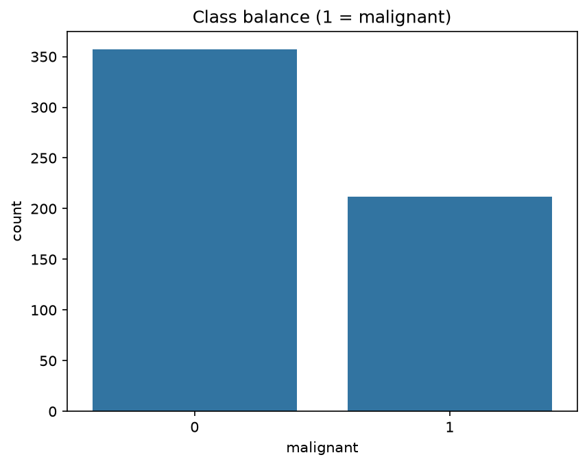
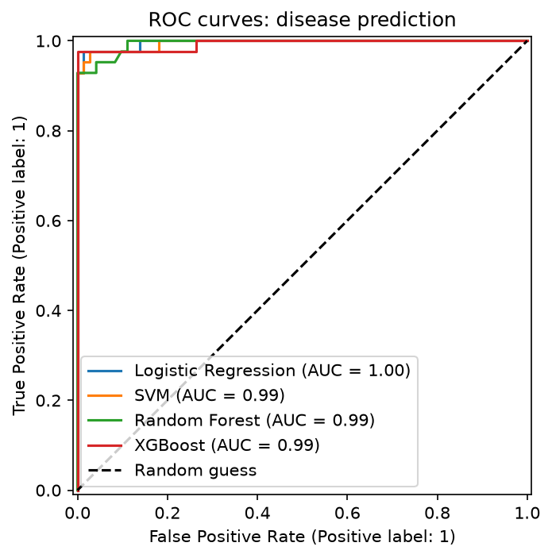
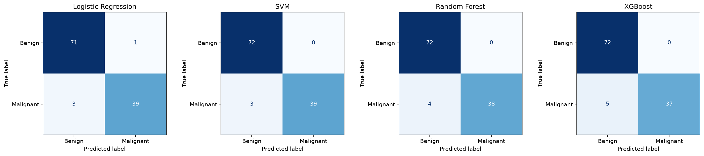
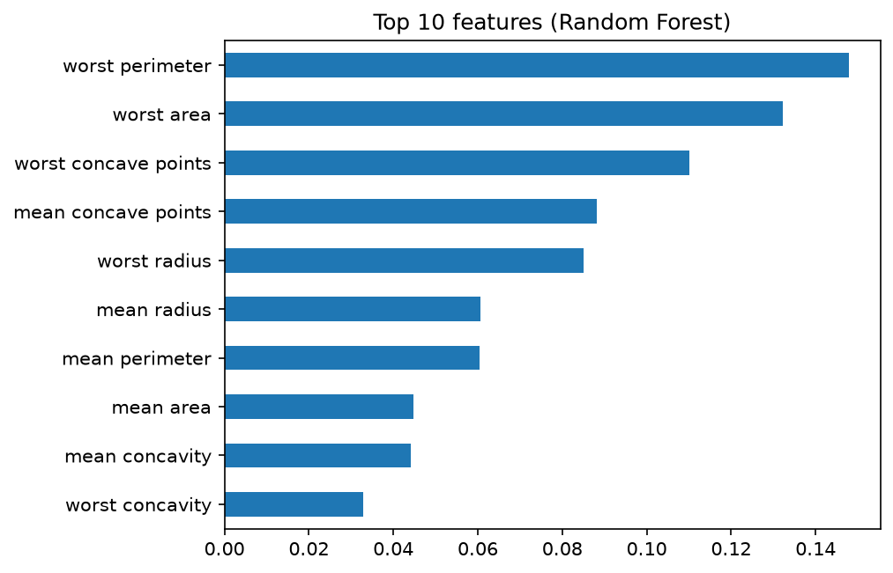

# Task 4: Disease Prediction from Medical Data

## Objective
Predict whether a breast tumour is malignant or benign from cell-nucleus measurements. The positive class is malignant (1), because missing a cancer is the costly mistake.

## Dataset
Breast Cancer Wisconsin (Diagnostic), UCI ML Repository, loaded with scikit-learn.
- 569 patients, 30 numeric features, no missing values
- 212 malignant (37.3%) and 357 benign

## Approach
1. EDA: class balance, boxplots, correlations
2. Stratified 80/20 split (455 train / 114 test)
3. Scaling inside a Pipeline for Logistic Regression and SVM
4. Models: Logistic Regression, SVM, Random Forest, XGBoost
5. Evaluation: Accuracy, Precision, Recall, F1, ROC-AUC, confusion matrices
6. 5-fold cross-validation and SVM tuning with GridSearchCV
7. Threshold chosen on training data only, then one final test

## Results (test set, default threshold)
| Model | Accuracy | Precision | Recall | F1 | ROC-AUC | Missed cancers (FN) | False alarms (FP) |
|---|---|---|---|---|---|---|---|
| Logistic Regression | 0.965 | 0.975 | 0.929 | 0.951 | 0.996 | 3 | 1 |
| SVM | 0.974 | 1.0 | 0.929 | 0.963 | 0.995 | 3 | 0 |
| Random Forest | 0.965 | 1.0 | 0.905 | 0.95 | 0.994 | 4 | 0 |
| XGBoost | 0.956 | 1.0 | 0.881 | 0.937 | 0.994 | 5 | 0 |

## Cross-validation (training data, mean ± std)
| Model | Recall | F1 | ROC-AUC |
|---|---|---|---|
| Logistic Regression | 0.953 ± 0.040 | 0.964 ± 0.021 | 0.996 ± 0.005 |
| SVM | 0.947 ± 0.034 | 0.961 ± 0.008 | 0.995 ± 0.005 |
| Random Forest | 0.935 ± 0.039 | 0.949 ± 0.021 | 0.989 ± 0.007 |
| XGBoost | 0.953 ± 0.024 | 0.961 ± 0.015 | 0.994 ± 0.004 |

Highest mean ROC-AUC: **Logistic Regression** (0.996). Models within one standard deviation of it, which the data cannot separate: Logistic Regression, SVM, XGBoost.

## Final model
SVC tuned with GridSearchCV, best parameters {'model__C': 10, 'model__gamma': 'scale'}, threshold 0.5.
Final test: Precision 1.000, Recall 0.929, F1 0.963, ROC-AUC 0.993.
It missed 3 of 42 malignant cases and raised 0 false alarms on 72 benign cases.

Top 5 features (Random Forest): worst perimeter, worst area, worst concave points, mean concave points, worst radius.

## Limitations
- Only 569 patients, so test metrics are noisy and small differences between models are not meaningful.
- The dataset is clean and curated; real hospital data would be harder.
- A learning project, not a diagnostic tool.

## How to run
Open `disease_prediction.ipynb` and click Run All.
